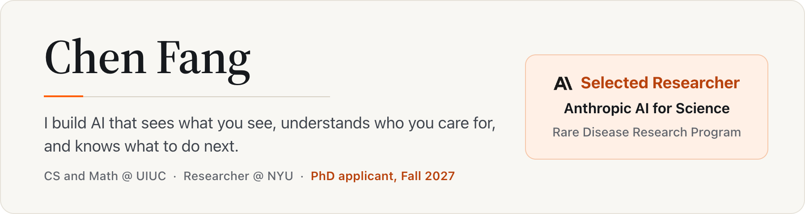
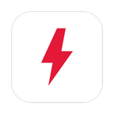
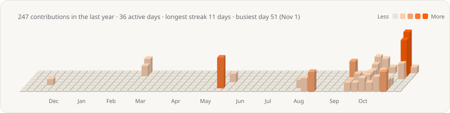

<picture>
  <source media="(prefers-color-scheme: dark)" srcset="assets/banner-dark.png">
  
</picture>

  
  
  
  
  
  

> [!NOTE]
> I'm applying to PhD programs for Fall 2027. Happy to talk research: [email me](mailto:chenf3@illinois.edu).

### News

- **Oct 2026** · Lightning talk on *Zebra or Horse?* at the kickoff of Anthropic's Rare Disease AI for Science cohort, one of 5 teams (out of 100 funded projects) to present.
- **Sep 2026** · Presented MedXRAgent at ECCV 2026 in Malmö, Sweden.
- **Sep 2026** · Awarded $50K in Claude credits through [Anthropic's AI for Science](https://www.anthropic.com/news/rare-disease-research-grants) rare-disease program: 1 of 100 projects funded from 750+ applications.
- **Jun 2026** · Both of our CVPR 2026 demos, EgoMedAgent and GazeAgent, were selected as **Spotlight** demos.

### Tools

<table>
  <tr>
    <td width="50%" valign="top">
       
      <b><a href="https://github.com/ChenFangfc/Oh_My_Cards">Oh My Cards</a></b> 
      Know which card to use and never miss a due date or a credit. Local-first, for macOS and the web.
    </td>
    <td width="50%" valign="top">
       
      <b><a href="https://github.com/ChenFangfc/BarTap">BarTap</a></b> 
      A tidy menu bar and live system stats for macOS, in one small app.
    </td>
  </tr>
  <tr>
    <td width="50%" valign="top">
       
      <b><a href="https://github.com/ChenFangfc/LogiMos">LogiMos</a></b> 
      Your Logitech mouse, set up in one small app: buttons, gestures and smooth scrolling.
    </td>
    <td width="50%" valign="top">
       
      <b><a href="https://github.com/ChenFangfc/OhMyTesla">OhmyTesla</a></b> 
      Your Tesla, your data, on your own machine: live status, Sentry alerts, drives and charging.
    </td>
  </tr>
</table>

### Contributions

<picture>
  <source media="(prefers-color-scheme: dark)" srcset="assets/contrib-dark.svg">
  
</picture>

### Stack

<picture>
  <source media="(prefers-color-scheme: dark)" srcset="https://skillicons.dev/icons?i=py%2Cpytorch%2Cts%2Creact%2Cswift%2Ctauri%2Cdocker%2Ccpp%2Cunreal%2Clinux&theme=dark">
  
</picture>
